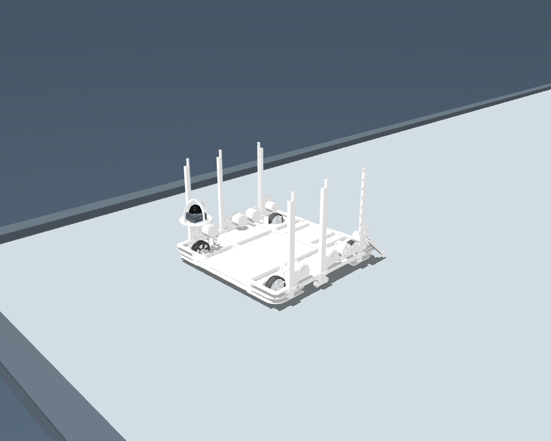
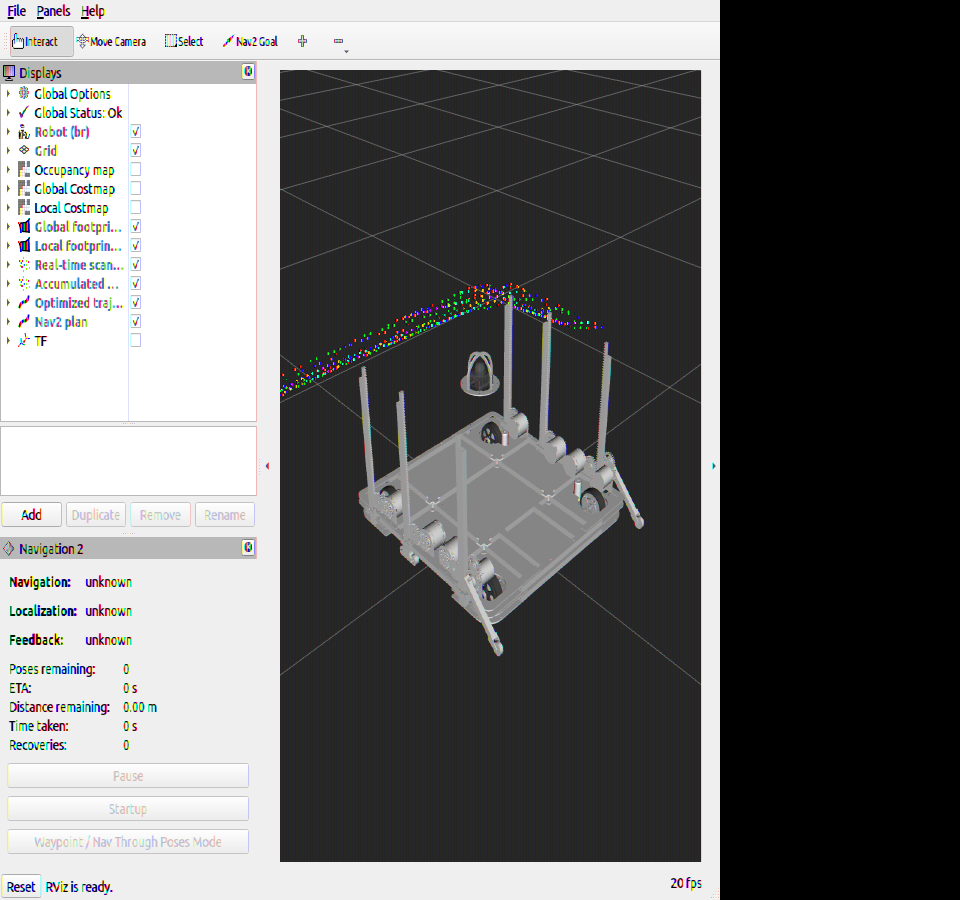

# Robocon MuJoCo 仿真（br + MID-360 + FAST-LIO2 + Nav2）

[](LICENSE)
[](https://docs.ros.org/en/humble/)
[](https://mujoco.org/)
[](https://github.com/hku-mars/FAST_LIO)

Robocon 赛场的完整仿真方案：MuJoCo 物理底盘 + Livox MID-360 非重复扫描仿真 + FAST-LIO2
建图/里程计 + 先验点云 ICP 重定位 + Nav2（SmacPlanner2D + MPPI Omni）全向导航。

本仓库基于 [WrenInk/slam_simulation](https://github.com/WrenInk/slam_simulation)（BSD-3-Clause）
改版，只保留 Robocon 主线：Robocon 场地、`br` 小车外观、FAST-LIO2 建图、先验地图导航和
Robocon 专用 launch/脚本。上游的 10×10 场地、可见小车模型、`mapping.sh`/`navigation.sh`
等已移除；上游归属与第三方许可见 [LICENSE](LICENSE)、[THIRD_PARTY.md](THIRD_PARTY.md)。

> **重要说明**：`br` 目前是**视觉外观**叠加在上游的四轮麦轮物理底盘上；`br` 的 6 轮、
> 升降/摆臂机构不参与物理。MuJoCo 窗口和 RViz 都显示 `br` 外观，但运动学仍由四轮
> 麦轮底盘驱动。



---

## 已验证内容

- **Robocon 场地**：`src/nav_stack/worlds/robocon_ground.xml`，由
  `tools/robocon_ground/model.sdf` 自动生成（120 个 geom，含边界墙、方块、斜坡）。
- **建图精度**：按用户逆时针路线完整绕场，FAST-LIO2 相对 MuJoCo 真值
  最大误差 **0.035–0.051 m**，终点误差约 **0.005 m**；停车后点云不再漂。
- **地图保存**：`/slam/save_map` 服务输出 `maps/map.pcd`、`map.pgm`、`map.yaml`。
- **导航**：先验点云 ICP 重定位 + Nav2，实测目标点 `SUCCEEDED`。
- **RViz 显示**：`Robot (br)` 读取 `/br_robot_description`，显示 `br` 外观；
  MuJoCo 窗口同样显示 `br`。



---

## 1. 环境与构建

要求：Ubuntu 22.04、ROS 2 Humble、Python 3.10。

```bash
sudo apt update && sudo apt install -y \
  build-essential cmake git python3-colcon-common-extensions \
  python3-venv python3-pip libeigen3-dev libpcl-dev pcl-tools \
  libgl1 libglfw3 ros-humble-desktop ros-humble-navigation2 \
  ros-humble-nav2-bringup ros-humble-pcl-ros ros-humble-pcl-conversions \
  ros-humble-sensor-msgs-py ros-humble-tf2-ros-py
```

获取代码：

```bash
cd ~ && mkdir ros2_ws && cd ~/ros2_ws #创建工作区
mkdir src && cd ~/ros2_ws/src
git clone https://github.com/Mumu-Asher/mujoco_backend.git
cd ~/ros2_ws/src/robocon_mujoco
chmod +x scripts/*.sh
./scripts/build.sh
```

`build.sh` 会：

1. 创建 `.venv/` 并安装 `requirements.txt`（mujoco、open3d 等）；
2. 编译并安装 `third_party/Livox-SDK2` 到 `.deps/`；
3. `colcon build --symlink-install` 编译 `FAST_LIO`、`livox_ros_driver2`、`nav_stack`；
4. 运行 `tests/`。

> 运行环境由 `scripts/env.sh` 统一设置：`ROS_DOMAIN_ID=77`、`ROS_LOCALHOST_ONLY=1`、
> `.venv`/`.deps` 路径。建图/导航脚本都会自动 source 它。


## 2. 建图

终端 1：

```bash
cd robocon_mujoco
./scripts/stop_all.sh          # 每次启动前先清理旧的仿真/FAST-LIO/RViz/RSP
./scripts/mapping_robocon.sh   # 无显示环境可加 gui:=false rviz:=false
```

终端 2：

```bash
./scripts/teleop.sh
```

- 启动后先等 1–2 秒，让 FAST-LIO2 完成静止初始化，再动车。
- 先旋转再直行，必要时降速；碰撞后如果点云已经错位，重启建图即可。
- 保存地图（建图仍运行时）：

```bash
ros2 service call /slam/save_map std_srvs/srv/Trigger "{}"
```

也可以在终端 1 按 `Ctrl+C`，`fastlio_map` 默认会在退出时自动保存。
输出：

```text
maps/map.pcd     # 3D 点云
maps/map.pgm     # 2D 占据栅格
maps/map.yaml    # 栅格元数据
```


## 3. 导航

先停止建图，再启动：

```bash
./scripts/stop_all.sh
./scripts/navigation_robocon.sh
```

- 等 RViz 里 `Navigation: active`，用 **Nav2 Goal** 点选目标。
- 先验地图默认 `maps/map.pcd` + `maps/map.yaml`；如果 `maps/` 为空，
  `navigation_robocon.sh` 会从最近的 `artifacts/` 建图结果里补一份。
- 可指定地图/初始位姿：

```bash
./scripts/navigation_robocon.sh \
  map_pcd:=maps/map.pcd map_yaml:=maps/map.yaml \
  initial_pose_x:=0.0 initial_pose_y:=0.0 initial_pose_yaw:=0.0
```

## 4. 进程清理与常见问题

```bash
./scripts/stop_all.sh
```

`stop_all.sh` 会按精确 PID 清理仿真器、FAST-LIO、bridge、Nav2、RViz 和
`omni_state_publisher`/`br_state_publisher`，还会清理本目录遗留的匿名
`robot_state_publisher`/RViz，并删除 DDS 共享内存。**不要用 `pkill -f` 一把梭。**

| 现象 | 处理 |
|---|---|
| RViz 模型分裂/闪烁、上下分离 | 通常是上一次启动的 RSP/RViz 没清干净。先 `./scripts/stop_all.sh`，再启动；确认 `ros2 topic info /br_robot_description` 只有 **1** 个发布者 |
| RViz 看不到 `br` | 检查 Display `Robot (br)` 的 Description Topic 是 `/br_robot_description`；Fixed Frame 为 `map`；先等 localizer 发布 `map -> odom` |
| RViz 有 `active samplers` / `Trying to create a map` 报错 | 建图 RViz 已禁用 `/map` 2D 栅格显示（Mesa 软渲染的 GLSL 冲突）；看 XYZ 体素图 `/slam/map_cloud` 即可 |
| 车在 RViz 里位置不对/下沉 | 栅格已按 map 地面 `z=-0.15` 放置；确认 FAST-LIO 初始化时车是静止的 |
| 导航目标不可达/规划失败 | 确认先验地图是本场地建出的 `maps/map.pcd`，且起始位姿与建图起点一致 |
| 启动时报缺少 `liblivox_lidar_sdk_shared.so` | 重新执行 `./scripts/build.sh`，确认 `.deps/lib` 已生成 |

## 5. 目录结构（Robocon 相关）

```text
.
├── README.md                     # 本文件
├── docs/
│   └── images/                   # br 截图
├── scripts/
│   ├── build.sh                  # 一键构建
│   ├── env.sh                    # ROS_DOMAIN_ID=77 等环境
│   ├── mapping_robocon.sh        # Robocon 建图入口
│   ├── navigation_robocon.sh     # Robocon 导航入口
│   ├── teleop.sh                 # 麦轮键盘控制
│   └── stop_all.sh               # 安全清理
├── src/nav_stack/
│   ├── launch/mapping_robocon.launch.py
│   ├── launch/navigation_robocon.launch.py
│   ├── worlds/robocon_ground.xml # 由 tools/robocon_ground/model.sdf 生成
│   ├── config/                   # FAST-LIO/地形/Nav2/RViz 配置
│   ├── models/br/                # br 模型、br_sim.urdf、抽稀网格
│   ├── urdf/br_display.urdf      # RViz 用（关节全部 fixed）
│   └── urdf/physics_base.urdf    # 不可见四轮物理底盘（仅物理/TF）
├── tools/
│   ├── gen_robocon_field.py      # SDF -> MuJoCo XML
│   ├── robocon_ground/model.sdf  # 场地源文件
│   ├── prep_br_meshes.py         # br 网格抽稀
│   └── make_br_display_urdf.py   # 生成 RViz 用 URDF
├── maps/                         # map.pcd / map.pgm / map.yaml
└── third_party/                  # Livox-SDK2（编译依赖）
```

上游的 10×10 场景、可见小车模型、`mapping.sh`/`navigation.sh`/`relocalize.sh`/
`omni_navigation.sh` 以及回环后端（`backend_node`/`pose_graph`/GTSAM）已移除；
Robocon 主线使用 `*_robocon.sh` + FAST-LIO2 + `fastlio_map`。

## 6. 许可与致谢

- 本仓库集成代码基于 [WrenInk/slam_simulation](https://github.com/WrenInk/slam_simulation)，
  原许可为 BSD-3-Clause，见 [LICENSE](LICENSE)。
- FAST-LIO2（GPL-2.0）、Livox 驱动、Nav2（Apache-2.0）等第三方组件的许可与来源见
  [THIRD_PARTY.md](THIRD_PARTY.md)、[LICENSES/](LICENSES/) 和
  [sources.lock.json](sources.lock.json)。
- `br` 模型来自项目提供的 CAD；MID-360 外观来自 Livox 官方模型。
